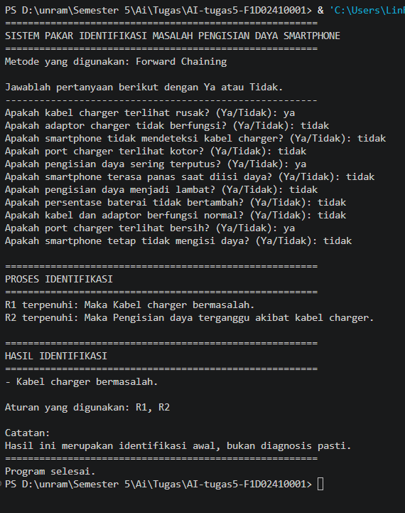
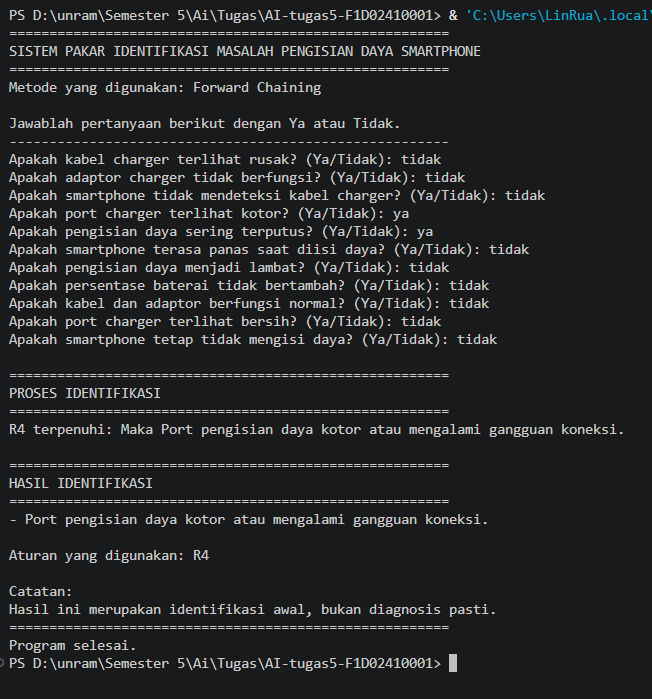
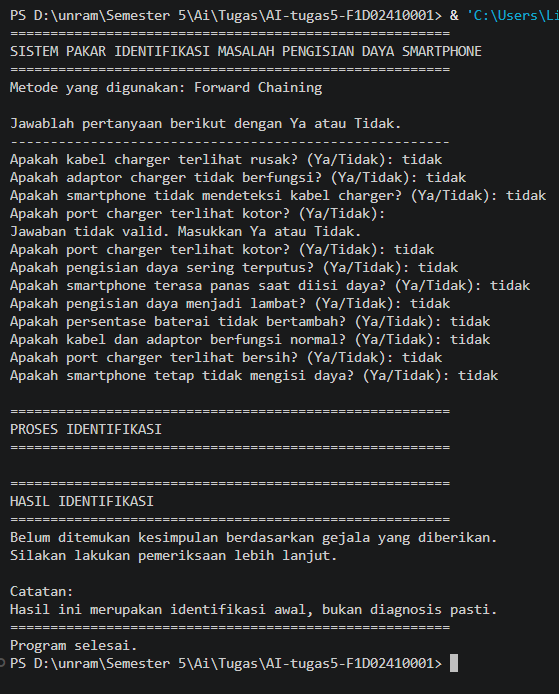

# AI-tugas5-F1D02410001

# Sistem Pakar Identifikasi Masalah Pengisian Daya Smartphone

## 1. Identitas

- **Nama:** Alif Taftazani Sanjaya
- **NIM:** F1D02410001
- **Mata Kuliah:** Kecerdasan Buatan
- **Topik:** Sistem Pakar Identifikasi Masalah Pengisian Daya Smartphone

## 2. Deskripsi dan Cara Menjalankan Program

Program ini merupakan sistem pakar sederhana yang digunakan untuk membantu mengidentifikasi kemungkinan penyebab masalah pengisian daya smartphone berdasarkan gejala yang dialami pengguna.

Program dibuat menggunakan:
- **Bahasa pemrograman:** Python
- **Versi Python:** 3.14.6
- **Metode:** Forward Chaining
- **Penyimpanan aturan:** JSON

### Struktur Folder

```text
AI-tugas5-F1D02410001/
│
├── main.py
├── aturan_cas_hp.json
├── README.md
│
└── screenshot/
    ├── pengujian_1.png
    ├── pengujian_2.png
    └── pengujian_3.png
```

### Cara Menjalankan

1. Pastikan Python sudah terinstal di komputer.
2. Buka folder `AI-tugas5-F1D02410001` melalui Terminal atau Command Prompt.
3. Jalankan perintah berikut:

```bash
python main.py
```

4. Jawab setiap pertanyaan gejala dengan `Ya` atau `Tidak`.
5. Program akan memeriksa aturan dan menampilkan hasil identifikasi.

## 3. Sumber Pengetahuan dan Tabel Aturan

### A. Daftar Sumber

Pengetahuan dalam sistem ini disusun berdasarkan informasi panduan resmi mengenai masalah pengisian daya smartphone.

| No. | Judul Sumber | Penerbit | URL | Tanggal Akses |
|---|---|---|---|---|
| 1 | If your iPhone or iPod touch won't charge | Apple Support | https://support.apple.com/en-us/108805 | 12 November 2026 |
| 2 | Samsung phone or tablet will not charge | Samsung Support | https://www.samsung.com/us/support/troubleshoot/TSG10001462/ | 12 November 2026 |
| 3 | Fix a Pixel phone that won't charge or turn on | Google Pixel Help | https://support.google.com/pixelphone/answer/7167687?sjid=17913023043162405875-NC | 12 November 2026 |

### B. Daftar Gejala

| Kode | Gejala |
|---|---|
| G01 | Kabel charger terlihat rusak |
| G02 | Adaptor charger tidak berfungsi |
| G03 | Smartphone tidak mendeteksi kabel charger |
| G04 | Port charger terlihat kotor |
| G05 | Pengisian daya sering terputus |
| G06 | Smartphone terasa panas saat diisi daya |
| G07 | Pengisian daya menjadi lambat |
| G08 | Persentase baterai tidak bertambah |
| G09 | Kabel dan adaptor berfungsi normal |
| G10 | Port charger terlihat bersih |
| G11 | Smartphone tetap tidak mengisi daya |

### C. Tabel Aturan

Aturan dibuat menggunakan kondisi IF-THEN. Artinya, apabila kondisi pada bagian IF terpenuhi, sistem akan menghasilkan kesimpulan pada bagian THEN.

| ID | Kondisi (IF) | Kesimpulan (THEN) |
|---|---|---|
| R1 | G01 | K01: Kabel charger bermasalah |
| R2 | K01 AND G05 | K01A: Pengisian daya terganggu akibat kabel charger |
| R3 | G02 | K02: Adaptor charger bermasalah |
| R4 | G04 AND G05 | K03: Port pengisian daya kotor atau mengalami gangguan koneksi |
| R5 | G06 AND G07 | K04: Pengisian daya kemungkinan dibatasi karena suhu tinggi |
| R6 | G09 AND G10 AND G03 AND G11 | K05: Kemungkinan terdapat masalah pada baterai atau perangkat keras smartphone |

**Keterangan:** K01 merupakan fakta antara yang dihasilkan oleh R1. K01 kemudian digunakan bersama G05 pada R2 untuk menghasilkan kesimpulan akhir K01A.

## 4. Metode yang Digunakan

Metode yang digunakan dalam program ini adalah **Forward Chaining**. Forward Chaining merupakan metode penalaran yang dimulai dari fakta atau gejala yang diketahui, kemudian sistem memeriksa aturan yang sesuai sampai memperoleh kesimpulan.

Alasan menggunakan metode Forward Chaining adalah karena program ini memulai proses dari jawaban pengguna terhadap pertanyaan gejala. Setelah itu, sistem mencocokkan jawaban tersebut dengan aturan yang sudah disimpan dalam file JSON.

### Langkah Kerja Forward Chaining

1. Pengguna menjawab pertanyaan mengenai gejala pengisian daya smartphone.
2. Jawaban `Ya` disimpan sebagai fakta awal.
3. Sistem memeriksa setiap aturan yang tersedia.
4. Jika seluruh kondisi dalam suatu aturan terpenuhi, kesimpulan dari aturan tersebut ditambahkan sebagai fakta baru.
5. Pemeriksaan diulangi selama masih terdapat fakta baru.
6. Jika tidak ada aturan lain yang terpenuhi, sistem menampilkan hasil identifikasi.

### Contoh Proses Penalaran

Misalnya pengguna memberikan jawaban:
- G01 = Ya, kabel charger terlihat rusak.
- G05 = Ya, pengisian daya sering terputus.

Proses penalarannya:

- **R1:** IF G01 THEN K01. Karena G01 terpenuhi, sistem menghasilkan K01, yaitu kabel charger bermasalah.
- **R2:** IF K01 AND G05 THEN K01A. Karena K01 dan G05 sudah terpenuhi, sistem menghasilkan K01A.

Kesimpulan akhirnya adalah **pengisian daya terganggu akibat kabel charger**.

Metode ini tidak menggunakan perhitungan matematis khusus karena proses penalarannya dilakukan dengan mencocokkan fakta dan aturan IF-THEN.

## 5. Pengujian Program dan Screenshot

Pengujian dilakukan menggunakan tiga kasus untuk mengetahui apakah sistem dapat menghasilkan kesimpulan sesuai dengan gejala yang diberikan.

### Kasus Uji 1: Masalah Kabel Charger

Jawaban yang diberikan:

| Gejala | Jawaban |
|---|---|
| G01 | Ya |
| G02 | Tidak |
| G03 | Tidak |
| G04 | Tidak |
| G05 | Ya |
| G06 | Tidak |
| G07 | Tidak |
| G08 | Tidak |
| G09 | Tidak |
| G10 | Ya |
| G11 | Tidak |

**Hasil yang diharapkan:**
- R1 terpenuhi dan menghasilkan K01.
- R2 terpenuhi dan menghasilkan K01A.
- Kesimpulan: Pengisian daya terganggu akibat kabel charger.

**Screenshot:**



### Kasus Uji 2: Masalah Port Charger

Jawaban yang diberikan:

| Gejala | Jawaban |
|---|---|
| G01 | Tidak |
| G02 | Tidak |
| G03 | Tidak |
| G04 | Ya |
| G05 | Ya |
| G06 | Tidak |
| G07 | Tidak |
| G08 | Tidak |
| G09 | Tidak |
| G10 | Tidak |
| G11 | Tidak |

**Hasil yang diharapkan:**
- R4 terpenuhi.
- Kesimpulan: Port pengisian daya kotor atau mengalami gangguan koneksi.

**Screenshot:**



### Kasus Uji 3: Tidak Ditemukan Kesimpulan

Jawaban yang diberikan:

| Gejala | Jawaban |
|---|---|
| G01 sampai G11 | Tidak |

**Hasil yang diharapkan:**

Tidak ada aturan yang terpenuhi sehingga program menampilkan pesan:

`Belum ditemukan kesimpulan berdasarkan gejala yang diberikan.`

**Screenshot:**



## 6. Batas Keberlakuan Sistem

Pengetahuan pada sistem pakar ini disusun berdasarkan panduan pemecahan masalah pengisian daya smartphone dari Apple Support, Samsung Support, dan pixelPhone suppport kemudian diterapkan pada sejumlah gejala umum yang dapat diamati pengguna. Sistem ini digunakan untuk membantu identifikasi awal masalah pengisian daya, seperti kabel charger rusak, adaptor bermasalah, port charger kotor, suhu perangkat tinggi, serta kemungkinan gangguan baterai atau perangkat keras. Sistem memiliki keterbatasan karena tidak mencakup seluruh merek, tipe smartphone, dan kemungkinan kerusakan yang ada. Hasil identifikasi hanya berupa saran berdasarkan aturan yang tersedia, bukan diagnosis teknis atau keputusan akhir. Jika masalah tetap terjadi, pengguna disarankan melakukan pemeriksaan lebih lanjut di tempat servis resmi atau teknisi yang berpengalaman.

## 7. Penggunaan Alat Bantu AI

Dalam pengerjaan tugas ini, dibantu ChatGPT untuk menyusun aturan IF-THEN.